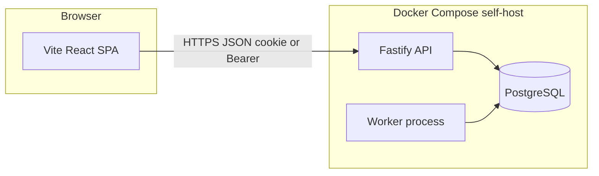

# Rescue Router — detailed phased implementation plan (v1)

This file is the **saved Phase 1 implementation plan** (first revision of the detailed technical plan). It covers delivery **phases 0 through 5** (foundation through backlog).

**Related:** [INITIAL_PLAN.md](./INITIAL_PLAN.md) · [ROADMAP.md](./ROADMAP.md)

**Implementation checklist (copy to issues if you prefer):**

- [ ] Phase 0: Monorepo scaffold, Drizzle schema (auth + orgs + invites), Better Auth + Fastify, invite/redeem APIs, web auth shell + org context, Compose + Mailpit + health endpoints
- [ ] Phase 1: Transports/dogs/legs schema + REST + coordinator UI + driver my-legs + SMTP invite wiring
- [ ] Phase 2: Run sheet UI, status + audit log, worker service + reminder jobs + optional pg-boss/jobs table
- [ ] Phase 3: Production Dockerfiles, compose prod overlay, backup/restore docs, README env reference
- [ ] Phase 4: CI image publish, K8s manifests/Helm sketch, migration Job pattern, runbook
- [ ] Phase 5 (backlog): maps API, PostGIS optional, Twilio, public tracking tokens, driver suggestion heuristic

---

## Baseline architecture (all phases)

Lock in a **Yarn workspaces monorepo** so `web`, `api`, and shared `packages/` can share TypeScript types and Zod schemas.

| Layer | Choice | Rationale |
| ----- | ------ | --------- |
| Frontend | **Vite 6**, **React 19**, **TypeScript** | Matches your React preference; static assets + any CDN; easy K8s side (nginx or object storage). |
| Routing / data | **TanStack Router**, **TanStack Query** | Typed routes, cache invalidation for CRUD-heavy coordinator UI. |
| Styling | **Tailwind CSS** + **shadcn/ui** (optional) | Fast, accessible UI without heavy custom CSS for MVP. |
| Backend | **Fastify 5**, **TypeScript** | Lightweight, good perf, schema-based validation via **TypeBox** or **Zod** + **fastify-type-provider-zod**. |
| Database | **PostgreSQL 16+** | Per [INITIAL_PLAN.md](./INITIAL_PLAN.md). |
| ORM / migrations | **Drizzle ORM** + **drizzle-kit** | Type-safe, SQL-like, migration files in repo; works with connection pooling (**postgres** package). |
| Auth | **Better Auth** + Drizzle adapter | Self-hosted sessions, email/password (and magic link later); organization model fits multi-tenant invites; mount via Fastify proxy to Better Auth handler. |
| Validation / API contract | **Zod**; optional **@asteasolutions/zod-to-openapi** later | Shared schemas in `packages/shared`. |
| Logging | **pino** + **pino-pretty** (dev) | Structured logs for VMs and K8s. |
| Email (dev) | **Mailpit** in Compose | Catches mail locally; prod: **Nodemailer** + SMTP or **Resend** API. |

**Alternatives (if you pivot):** Next.js App Router + Auth.js + Drizzle (one deployable unit); or tRPC instead of REST (add `@trpc/server` / `@trpc/client`). This plan assumes **REST JSON** from Fastify for maximum clarity in self-host and K8s split.

**Repo layout (target):**

- `apps/web` — Vite SPA
- `apps/api` — Fastify server + Better Auth routes
- `apps/worker` — thin entry that imports job runners (Phase 2+); same TS build as `api` or shared package
- `packages/db` — Drizzle schema + migrations
- `packages/shared` — Zod DTOs, role enums, constants
- `docker-compose.yml`, `Dockerfile.api`, `Dockerfile.web` (Phase 3–4)

---

## Global dependencies (install per app/package)

**Root:** `typescript`, `eslint`, `prettier`, Yarn workspace config.

**`apps/web`:** `react`, `react-dom`, `vite`, `@vitejs/plugin-react`, `@tanstack/react-router`, `@tanstack/react-query`, `tailwindcss`, `postcss`, `autoprefixer`, `zod` (if validating forms client-side from shared).

**`apps/api`:** `fastify`, `@fastify/cors`, `@fastify/helmet`, `@fastify/cookie`, `@fastify/rate-limit`, `pino`, `drizzle-orm`, `postgres`, `better-auth`, `zod`, `nodemailer` (invites + notifications). Prefer Better Auth for password hashing over separate `bcrypt`.

**`packages/db`:** `drizzle-orm`, `drizzle-kit`, `postgres`, Better Auth schema helpers if generated.

**Dev / quality:** `vitest`, `@testing-library/react`, `msw` (optional API mocking for web), `@types/node`.

**Phase 2 worker:** `node-cron` or **graphile-worker** (durable Postgres-backed jobs without Redis). For minimal deps: dedicated `worker` process + `SELECT ... FOR UPDATE SKIP LOCKED` on an `outbox` / `jobs` table, or **pg-boss** (Postgres only).

---

## Phase 0 — Foundation

**Goals:** Local dev parity, auth login, orgs + memberships, invite + redeem, health + logging, tenant guard on API.

**Database (Drizzle migrations):**

- Tables per [INITIAL_PLAN.md](./INITIAL_PLAN.md) §7: `organizations`, `users` (align with Better Auth user table—merge conceptually), `organization_members` (`user_id`, `organization_id`, `role` enum: `admin` | `coordinator` | `driver`, unique pair), `invitations` (`token_hash`, `email`, `organization_id`, `role`, `expires_at`, `accepted_at`).
- Better Auth tables: follow official Drizzle schema (session, account, verification, etc.).
- Add composite indexes: `organization_members(organization_id)`, `invitations(organization_id, email)` where helpful.

**Auth flows:**

1. Sign-up / sign-in (email + password) via Better Auth.
2. **Bootstrap first org:** e.g. `POST /api/orgs` for authenticated user creates org + `organization_members` row as `admin` (only if you allow self-serve org creation) *or* seed script for controlled pilot—product choice; document one path.
3. **Invite:** `POST /api/orgs/:orgId/invitations` (admin/coordinator) creates row + sends email with link `https://app/accept-invite?token=...`.
4. **Redeem:** `POST /api/invitations/redeem` with token; verify hash, expiry, single use; insert `organization_members`; mark invitation accepted.

**API middleware:**

- Resolve session → `userId`.
- For org-scoped routes: load `organization_members` for `(userId, orgId from URL or header)`; reject 403 if missing.
- **Never** trust client `organization_id` on body without membership check.

**Frontend:**

- Pages: login, register, accept invite, empty dashboard shell with org switcher (read memberships from API).
- Global **org context** (TanStack Query): `GET /api/me/memberships`.

**Infra:**

- `docker-compose.yml`: **postgres** service, optional **mailpit** (ports 1025/8025), **api** optional after Dockerfile exists (can be `yarn dev` on host in earliest week).
- `GET /healthz` on API (no DB) and `GET /readyz` (DB ping).

**Exit criteria:** Two users, two orgs, API tests or manual script proving no cross-org reads on at least one protected endpoint.

---

## Phase 1 — MVP domain

**Goals:** CRUD transports, dogs, legs; coordinator UI; driver “my legs” read-only.

**Schema additions:**

- `transports`: `organization_id`, title/notes, `origin_text`, `destination_text`, `window_start`, `window_end`, `status` enum (`draft` | `scheduled` | `in_progress` | `completed` | `cancelled`).
- `dogs`: `organization_id`, name, `care_notes`, optional photo URL later.
- `transport_dogs`: `(transport_id, dog_id)` PK.
- `legs`: `transport_id`, `sequence` (unique per transport), `start_location`, `end_location` (text v1), `planned_start`, `planned_end`, `assigned_user_id` nullable FK to users, `status` enum.
- `volunteer_profiles` (optional in Phase 1): defer if tight; else `user_id`, `organization_id`, JSON or columns for prefs.

**API surface (REST examples):**

- `GET/POST /api/orgs/:orgId/transports`, `GET/PATCH/DELETE /api/orgs/:orgId/transports/:id`
- Nested or flat: `.../legs` collection with reorder endpoint `PATCH .../legs/reorder` (array of ids).
- `GET /api/orgs/:orgId/dogs` + CRUD
- `GET /api/me/legs?upcoming=true` — joins through `organization_members` and `legs.assigned_user_id`

**Frontend:**

- Coordinator: transport list + detail with leg list; assign driver dropdown (org members with role driver/coordinator as needed); dog multi-select on transport.
- Driver: “My upcoming legs” + leg detail (addresses, map deep link to Google/Apple Maps from encoded addresses).

**Email:**

- Invite emails via Nodemailer + Mailpit (dev); production SMTP env vars.

**Exit criteria:** Full happy path documented in README: invite driver → coordinator builds transport → assigns legs → driver sees legs.

---

## Phase 2 — Day-of execution

**Goals:** Run sheet, status transitions, audit timestamps, reminder worker.

**Schema / behavior:**

- Leg and transport status transitions with `updated_at` and optional `completed_at`; append-only `leg_events` or `audit_log` table (`actor_user_id`, `leg_id`, `action`, `payload jsonb`, `created_at`) for handoff trail.
- Transport “run sheet” aggregates: transport + dogs + all legs with driver names/phones (from user profile or `volunteer_profiles`).

**Frontend:**

- Run sheet route: print CSS (`@media print`) hiding chrome; optional “Export PDF” later (browser print first).

**Worker (`apps/worker`):**

- Poll or cron: find transports with first leg in T+48h / T+1h windows; enqueue notifications in `notifications` table or send directly with idempotency key `(transport_id, template, fire_time_bucket)`.
- Docker Compose `worker` service: same image as API with `CMD ["node","apps/worker/dist/index.js"]` (or dedicated Dockerfile stage).

**Dependencies:** Phase 2 adds either **pg-boss** or minimal **`jobs` table** + locking pattern; add Nodemailer templates or **react-email** for HTML emails (optional devDependency in `packages/email`).

**Exit criteria:** Coordinator runs day-of from run sheet; at least one automated reminder in staging with Mailpit proof.

---

## Phase 3 — Hardening (self-host)

**Goals:** Production Compose, TLS proxy story, backups, restore drill.

**Deliverables:**

- Multi-stage **`Dockerfile.api`**: build TS, run `node dist/server.js`; run migrations via **`drizzle-kit migrate`** in entrypoint script or documented manual step (prefer **init job** pattern for K8s alignment).
- **`Dockerfile.web`**: `vite build` → nginx or **Caddy** static with SPA fallback.
- **`docker-compose.prod.yml`** (or overrides): env files, volume for PG data, restart policies, resource limits.
- **Backup doc:** `pg_dump` cron on host or sidecar; retention; test restore on a scratch DB.
- **README:** required env vars (`DATABASE_URL`, `AUTH_SECRET`, `SMTP_*`, `APP_URL`, `CORS_ORIGIN`).

**Optional hardening:** `@fastify/rate-limit` tuned; helmet; CSP headers for static site.

**Exit criteria:** Documented restore test; Compose brings up app + DB + mail sink.

---

## Phase 4 — Cloud / Kubernetes readiness

**Goals:** Same images on registry; config-only differences; optional K8s manifests.

**Deliverables:**

- CI (GitHub Actions or similar): **lint, test, build**, push images to GHCR/Docker Hub (`rescue-router-api`, `rescue-router-web`, same tag).
- **K8s (plain YAML):** `Deployment` + `Service` for api and web; `Deployment` for worker; `Secret` for `DATABASE_URL` / auth; `ConfigMap` for non-secrets; **Ingress** (TLS via cert-manager or cloud LB).
- **Job** or init container: `drizzle-kit migrate` using image that includes `packages/db`.
- **Operational doc:** scaling notes (stateless API; single worker with leader election later if multiple replicas—defer or use **pg-boss**’s single scheduler pattern).

**Exit criteria:** Runbook: deploy to k3s or kind cluster with external managed Postgres; smoke test login + create transport.

---

## Phase 5 — Nice-to-haves (prioritized backlog)

| Feature | Typical dependencies |
| ------- | -------------------- |
| Map + drive times | **Mapbox GL** or Google Maps JS; server: Mapbox Directions API or OSRM; optional **PostGIS** + `geography` columns in Drizzle. |
| SMS | **Twilio** SDK; consent and opt-in storage. |
| Public tracking | Unsigned token on transport + rate limit; read-only API. |
| Suggest next driver | Heuristic service using volunteer home geocode + leg endpoints; no new mandatory deps beyond maps. |

---

## Risk notes

- **Better Auth + Fastify** mounting must follow current docs (handler as fetch or Node adapter); verify organization plugin expectations vs custom `organization_members` table—you may map Better Auth org plugin tables to your canonical model to avoid duplication.
- **CORS + cookies:** For SPA on different subdomain than API, configure SameSite, Secure, and explicit CORS origin early to avoid production surprises.
- **Migrations:** Never rely solely on auto-migrate on boot in K8s without rollover strategy; use explicit Job.

---

## Suggested follow-up (when implementation starts)

Add `planning/IMPLEMENTATION_STACK.md` (or extend [ROADMAP.md](./ROADMAP.md)) with pinned package versions so the repo stays the source of truth.
